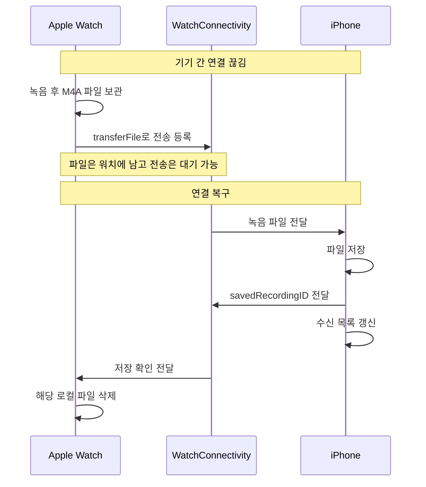
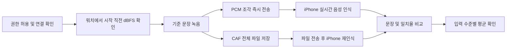

# AppleWatchPoC

## 소개

Apple Watch의 마이크로 녹음한 음성을 페어링된 iPhone으로 전달하는 과정을 검증하는 SwiftUI 프로젝트입니다. iPhone 앱과 watchOS 앱에 각각 대응하는 두 가지 테스트 메뉴가 있습니다.

첫 번째 **녹음 · 아이폰 동기화**는 연결이 끊긴 동안 워치가 녹음 파일을 보관하고, 연결이 복구되면 iPhone으로 보내는 동작을 확인합니다. iPhone의 저장 확인을 받은 후에만 워치 파일을 삭제합니다. 두 번째 **소음·거리 음성 기록 테스트**는 워치 마이크의 입력 수준과 iPhone의 음성 인식 결과를 기록해 환경 조건별로 비교합니다. 거리 자체를 자동 측정하지는 않습니다.

| 메뉴 | Apple Watch | iPhone |
| --- | --- | --- |
| 녹음 · 아이폰 동기화 | 녹음 시작·중지, 보관 중인 파일과 전송 상태 확인, 전송 재시도 | 수신 파일 재생·삭제, 수신 시각·길이·전송 측정값 확인 |
| 소음·거리 음성 기록 테스트 | 녹음 직전 마이크 입력 수준 표시, 시험 녹음 시작·중지 | 기준 문장, 실시간·파일 기반 음성 인식 결과와 일치율, 입력 수준별 평균 확인 |

## 프로젝트 구조와 사용 프레임워크

Xcode 프로젝트는 `AppleWatchPoC.xcodeproj`이며 `AppleWatchPoC`(iOS)와 `AppleWatchPocWatch Watch App`(watchOS) 두 타깃으로 구성됩니다. 프로젝트 설정상 Swift 5, iOS/watchOS 배포 대상 27.0입니다. 외부 패키지 의존성은 없습니다.

| 프레임워크 | 사용처 |
| --- | --- |
| SwiftUI | 두 앱의 화면, 내비게이션, 앱 진입점 |
| Combine | `ObservableObject`, `@Published`, ViewModel의 상태 전달, 연결 상태 갱신 타이머 |
| WatchConnectivity | `WCSession`을 통한 즉시 메시지, 백그라운드 파일 전송, 저장 확인·측정값 전달 |
| AVFoundation | 워치 녹음·입력 레벨 측정·PCM 캡처, iPhone 파일 재생·녹음 길이 조회 |
| Speech | iPhone의 한국어(`ko-KR`) 실시간 음성 인식과 수신 파일 음성 인식 |
| Foundation | 파일 관리, UUID, `UserDefaults`, JSON 직렬화, 시간 계산 |

## 1. 녹음 · 아이폰 동기화 테스트

### 사용 흐름

워치는 녹음이 끝나면 파일을 바로 지우지 않고 `Recordings` 디렉터리에 둡니다. `transferFile`을 요청한 뒤에도 iPhone의 **저장 확인 메시지**를 받을 때까지 보관합니다. 연결이 끊긴 동안에는 WatchConnectivity의 파일 전송 대기열에 남을 수 있고, 연결이 복구되면 시스템이 전달합니다. 워치 앱은 연결 상태가 다시 `reachable`이 될 때 아직 대기열에 없는 파일도 재등록합니다. 화면의 **동기화 재시도**는 이 등록을 수동으로 다시 실행합니다.

### 테스트 방법

| 단계 | 조작 | 확인할 결과 |
| --- | --- | --- |
| 1. 준비 | 페어링된 iPhone과 Apple Watch에 두 앱을 설치·실행하고, 각각의 녹음 동기화 화면을 엽니다. 워치의 마이크 권한을 허용합니다. | 기존 파일과 혼동되지 않도록 양쪽 목록의 현재 상태를 확인합니다. |
| 2. 연결 차단 | 워치와 iPhone 사이의 실제 통신 경로를 끊습니다. 예를 들어 두 기기를 충분히 떨어뜨리거나, 워치의 Bluetooth·Wi-Fi·셀룰러 등 사용 가능한 연결을 끕니다. | 워치에 **실시간 연결 안 됨**이 표시되고, 이후 새 녹음이 iPhone에 도착하지 않는지 확인합니다. 단순히 iPhone 앱을 백그라운드로 보내는 것만으로는 파일 전송까지 차단되지 않을 수 있습니다. |
| 3. 오프라인 녹음 | 워치에서 **녹음 시작**을 누르고 몇 초 말한 뒤 **녹음 중지**를 누릅니다. | 워치의 **워치에 보관 중** 목록에 새 UUID 파일이 남고, iPhone의 **워치에서 받은 녹음** 목록에는 아직 나타나지 않습니다. |
| 4. 연결 복구 | 차단한 통신 경로를 복구하고 두 앱을 확인합니다. 필요하면 워치에서 **동기화 재시도**를 누릅니다. | 전송 대기·진행 상태를 거쳐 같은 UUID의 파일이 iPhone 목록에 나타납니다. 백그라운드 파일 전송이므로 도착까지 시간이 걸릴 수 있습니다. |
| 5. 저장 확인 | iPhone에서 새 파일을 재생하고, 워치의 보관 목록을 다시 봅니다. | iPhone에서 녹음이 들리고, 저장 확인(`savedRecordingID`)이 워치에 도착하면 워치 목록에서 파일이 사라집니다. 전송 완료 직후에도 확인 메시지가 아직 오지 않았다면 잠시 남을 수 있습니다. |

**판정 기준:** 3단계에서 iPhone에 파일이 도착하지 않은 채 워치에 남고, 4~5단계에서 같은 UUID의 파일이 iPhone으로 전달·재생되며 저장 확인 후 워치에서 제거되면 핵심 동작을 확인한 것입니다. 워치의 **실시간 연결 안 됨**은 `sendMessage` 가능 여부를 뜻하며, 백그라운드 파일 전송 가능 여부와 정확히 같지는 않습니다. 오프라인 보관을 검증하려면 3단계에서 **iPhone에 실제로 파일이 도착하지 않았는지**도 함께 확인해야 합니다.

### 구현 흐름

| 순서 | 처리 위치 | 실제 동작 |
| --- | --- | --- |
| 1. 녹음 | 워치 | 마이크 권한을 받은 뒤 `AVAudioSession`을 활성화하고 `AVAudioRecorder`로 `Documents/Recordings/<UUID>.m4a`에 저장합니다. 형식은 AAC, 16 kHz, 모노, 32 kbps입니다. |
| 2. 전송 등록 | 워치 | 녹음 중지 후 `queuePendingRecordings()`가 아직 등록되지 않은 파일을 찾아 `WCSession.transferFile(_:metadata:)`에 넣습니다. `recordingID`, `fileBytes`, `fileExtension`을 함께 보냅니다. **동기화 재시도**도 같은 함수를 호출합니다. |
| 3. 연결 대기 | 워치·시스템 | 전송을 등록해도 워치의 원본 파일은 유지됩니다. 통신할 수 없으면 WatchConnectivity가 전송을 대기시키고, 연결 복구 후 전달합니다. |
| 4. 수신·저장 | iPhone | `didReceive file`에서 임시 파일을 `Documents/ReceivedRecordings/<UUID>.m4a`로 옮깁니다. 같은 UUID가 이미 있으면 중복 저장하지 않고, 수신 시각과 녹음 길이를 기록합니다. |
| 5. 저장 확인 | iPhone → 워치 | iPhone이 `transferUserInfo(["savedRecordingID": id])`를 보냅니다. 워치는 이 메시지를 받은 뒤에만 원본 파일을 삭제합니다. |
| 6. 확인·재생 | iPhone | 목록에서 파일을 `AVAudioPlayer`로 재생하거나 삭제합니다. 이 삭제는 iPhone 저장본에만 적용됩니다. |

`transferFile`과 `transferUserInfo`는 즉시 연결 여부와 별개로 시스템이 백그라운드에서 전달할 수 있는 WatchConnectivity 전송 방식입니다. 반면 화면의 **실시간 연결 가능**은 즉시 메시지를 주고받을 수 있는지 나타냅니다. 워치는 `isReachable`일 때 `connectionProbe` 메시지를 보내 응답을 확인하고, 화면이 보이는 동안 2초마다 다시 확인합니다. iPhone은 페어링 여부와 워치 앱 설치 여부도 상태에 반영합니다.

### 전송 시간 표시의 의미

워치는 실시간 연결 상태에서 파일을 전송 대기열에 넣거나, 대기 중인 파일에 실시간 연결이 다시 확인된 시각을 시작점으로 기록합니다. `didFinish fileTransfer`가 성공하면 그 시작점부터의 경과 시간과 파일 크기를 `transferUserInfo`로 iPhone에 보냅니다. iPhone은 `파일 크기 ÷ 경과 시간`으로 MB/s를 표시합니다. 연결된 시작 시각이 없으면 시간 측정 불가로 표시됩니다. 이 값에는 대기 시간이 포함될 수 있으므로 순수 무선 전송 속도나 정확한 송신 시작부터 수신 저장까지의 시간은 아닙니다.

## 2. 소음·거리 음성 기록 테스트

### 사용 흐름

### 테스트 방법

| 단계 | 조작 | 확인할 결과 |
| --- | --- | --- |
| 1. 준비 | iPhone과 워치에서 **소음·거리 음성 기록 테스트**를 엽니다. iPhone의 음성 인식 권한과 워치의 마이크 권한을 허용합니다. | 워치에 dBFS 숫자가 나타나고 iPhone에 기준 문장이 보입니다. 워치가 **실시간 연결 가능** 상태여야 합니다. |
| 2. 기준 조건 | 조용한 곳에서 워치를 착용하고 발화자와 워치 사이 거리를 일정하게 정합니다. iPhone의 기준 문장을 보며 워치에서 **녹음 시작**을 누르고 문장을 말한 뒤 **녹음 중지**를 누릅니다. | iPhone에 시험 항목이 생기고 **시작 직전 입력**, **실시간**, **파일 변환** 상태가 차례로 표시됩니다. |
| 3. 결과 확인 | 실시간·파일 변환이 모두 **완료**될 때까지 기다립니다. | 두 인식 문장과 각각의 일치율이 표시되고, 해당 dBFS 구간의 평균 집계에 시험이 포함됩니다. 전송이 끊겼으면 경고를 확인합니다. |
| 4. 조건 비교 | 같은 문장을 비슷한 목소리 크기로 반복하면서 거리 또는 주변 소음 조건을 한 번에 하나씩 바꿉니다. 조건별로 여러 번 녹음합니다. | 개별 일치율과 **입력 수준별 평균**을 비교합니다. 실제 거리와 환경 조건은 앱이 저장하지 않으므로 별도로 메모해 각 시험 시각과 대응시킵니다. |

**판정 기준:** 시험별로 시작 직전 dBFS와 실시간·파일 인식 문장/일치율이 기록되고, 완료된 시험만 입력 수준별 평균에 반영되는지 확인합니다. 연결이 끊겨 **실시간** 경로가 실패하면 경고가 표시될 수 있습니다. 그 경우에도 전체 CAF 파일이 나중에 전달되면 **파일 변환** 결과를 별도로 확인할 수 있습니다.

### 구현 흐름

| 순서 | 처리 위치 | 실제 동작 |
| --- | --- | --- |
| 1. 입력 수준 측정 | 워치 | 임시 `AVAudioRecorder`의 미터를 0.3초마다 읽어 dBFS를 표시합니다. 이전 값 70%와 새 값 30%를 섞고, 시작 직전 값을 `ambientDBFS`로 저장합니다. |
| 2. 녹음 시작 | 워치 | 즉시 연결과 마이크 권한을 확인한 뒤 `AVAudioEngine`으로 Float32 PCM을 캡처합니다. `Documents/Recordings/<UUID>.caf`에 기록하면서 녹음 중 RMS 입력 수준도 갱신합니다. |
| 3. 실시간 인식 준비 | 워치 → iPhone | `speechTestEvent: start`에 시험 ID·샘플레이트·dBFS를 담아 보냅니다. iPhone은 음성 인식 권한과 서비스를 확인해 `ready: true`로 응답합니다. |
| 4. 실시간 인식 | 워치 → iPhone | 워치가 약 0.25초 분량의 PCM을 `chunk` 메시지로 보냅니다. iPhone은 `SFSpeechAudioBufferRecognitionRequest`에 붙여 한국어 부분 인식 결과를 갱신합니다. |
| 5. 녹음 종료 | 워치 → iPhone | 워치가 남은 샘플과 `stop` 메시지를 보냅니다. iPhone은 입력을 종료하고 최종 결과를 기다립니다. 8초 안에 마무리되지 않으면 지연·중단 상태로 표시합니다. |
| 6. 파일 재인식 | 워치 → iPhone | 워치가 전체 CAF를 `transferFile`로 보냅니다. iPhone은 저장 후 `SFSpeechURLRecognitionRequest`로 다시 인식하고, 저장 확인 메시지를 워치에 보냅니다. |
| 7. 결과 비교 | iPhone | 기준 문장 **“오늘은 바람이 불지만 산책하기 좋은 날입니다”**에 대한 실시간·파일 인식 문장과 각각의 일치율을 보여 줍니다. |

현재 신규 시험은 `mode: "both"`로 생성됩니다. 수신 로직과 모델에는 이전/다른 데이터의 `"live"`, `"after"` 모드도 처리하는 분기가 있지만, 현재 워치 화면에서 선택하는 모드는 없습니다. 시험 시작 실패 시 워치는 캡처와 로컬 파일을 정리하고, 가능한 경우 `cancel` 메시지를 보냅니다. 실시간 `chunk` 전송이 실패하거나 연결이 끊기면 `speechStreamInterrupted`를 기록해 iPhone 결과에 경고를 표시합니다.

### 소음·거리 비교 로직과 해석

`PhoneRecordingModels.swift`의 `AmbientNoiseBand`는 **녹음 시작 직전 입력 dBFS**를 세 구간으로 나눕니다.

| 범위 | 화면 표시 |
| --- | --- |
| `dBFS < -50` | 조용한 편 |
| `-50 ≤ dBFS < -30` | 생활 소음 수준 |
| `dBFS ≥ -30` | 시끄러운 편 |

일치율은 기준 문장과 인식 문장을 소문자로 바꾸고 공백·문장부호를 제거한 다음, **문자 단위 편집 거리**를 계산합니다. `max(0, 1 - 편집 거리 / 기준 문장 글자 수) × 100`을 반올림한 값입니다. 실시간·파일 인식이 모두 `완료`이고 dBFS가 있는 `both` 시험만 구간별 평균에 포함합니다.

**거리 자체는 앱에서 측정하지 않습니다.** 거리 센서값이나 실측 dB SPL도 사용하지 않습니다. 화면의 dBFS는 워치 마이크가 받은 디지털 입력 레벨이며, 주변 소음만 분리한 측정값도 아닙니다. 거리에 따른 차이를 보려면 사용자가 발화 문장·목소리 크기·환경을 가급적 일정하게 유지하고 거리만 바꿔 반복 시험한 뒤 결과를 비교해야 합니다. 거리값을 입력하거나 기록하는 기능은 현재 없습니다.

## iPhone ↔ Apple Watch 통신 요약

| 방향·API | 데이터 | 사용 조건·목적 |
| --- | --- | --- |
| 워치 → iPhone `sendMessage` | `connectionProbe` | 즉시 연결 확인. iPhone이 응답 |
| 워치 → iPhone `sendMessage` | `speechTestEvent`: `start`, `chunk`, `stop`, `cancel` | 실시간 음성 시험 제어와 PCM 전달. 즉시 연결 필요 |
| 워치 → iPhone `transferFile` | M4A/CAF 파일과 UUID·크기·형식·시험 메타데이터 | 녹음 완료 후 시스템 파일 전송 대기열 사용 |
| iPhone → 워치 `transferUserInfo` | `savedRecordingID` | iPhone 저장 확인. 워치 로컬 파일 삭제 트리거 |
| 워치 → iPhone `transferUserInfo` | `transferMetricID`, `fileBytes`, 선택적 `elapsedSeconds` | 전송 완료 측정값 표시 |

두 앱은 같은 UUID를 파일명, 메시지의 `id`, 전송 메타데이터의 `recordingID`, 저장 확인의 `savedRecordingID`에 사용해 하나의 녹음/시험을 연결합니다. 파일은 각 앱의 자체 Documents 디렉터리에 저장되고, 전송 측정값·녹음 상세 정보·시험 결과는 각 앱의 `UserDefaults`에 저장됩니다. `WCSession`은 앱 간 데이터 전달을 담당하며 오디오 녹음이나 음성 인식 자체를 수행하지 않습니다.

## 손 제스처 연동 검토

**현재 프로젝트에는 손 제스처나 단축어를 실행하는 코드가 없습니다.** 아래는 향후 도입을 위한 검토 내용과 이전 시도에서 관찰한 문제입니다.

- **시스템 더블 탭:** SwiftUI의 `.handGestureShortcut(.primaryAction)`을 버튼에 적용하면 지원되는 Apple Watch에서 엄지와 검지를 두 번 맞대는 시스템 더블 탭을 그 버튼의 주 동작에 연결할 수 있습니다. 현재 앱의 녹음 버튼에는 적용되어 있지 않습니다. [Apple 개발자 문서](https://developer.apple.com/documentation/watchos-apps/enabling-double-tap)
- **다른 손 제스처:** 집기, 두 번 집기, 주먹 쥐기 등의 동작을 더 다양하게 쓰려면 Apple Watch의 **설정 → 손쉬운 사용 → AssistiveTouch → 손 제스처**를 켜고, 제스처에 시스템 동작이나 Siri 단축어를 지정하는 방식을 검토할 수 있습니다. AssistiveTouch가 켜져 있으면 위의 시스템 더블 탭은 사용할 수 없습니다. [Apple Watch 사용 설명서](https://support.apple.com/en-ie/guide/watch/apdec70bfd2d/watchos)
- **손목 움직임:** [Core Motion](https://developer.apple.com/documentation/coremotion/)의 가속도·회전 데이터를 분석해 앱에서 손목 움직임을 제스처로 인식하는 방식도 구현할 수 있습니다. 다만 Apple Watch의 시스템 손목 제스처와 동작이 겹치면 의도하지 않은 반응이나 중복 동작이 생겨 사용자에게 불편할 수 있다고 생각합니다. 따라서 현재는 도입하지 않았으며, 적용한다면 시스템 동작과 충돌하는지 실제 기기에서 먼저 확인해야 합니다.
- **남은 문제:** 개발 관점에서는 앱 기능을 단축어로 노출하고 AssistiveTouch 제스처에 연결하는 방안이 적합해 보입니다. 이전 시도에서는 단축어가 실행할 기능 자체는 동작했지만, **제스처에 연결했을 때 단축어가 실행되지 않는 현상**이 있었습니다. 원인은 아직 확인되지 않았으며, 향후 다시 구현할 때 기기 설정·단축어의 Apple Watch 표시 및 실행 여부·제스처 할당 경로를 실제 기기에서 확인해야 합니다.

## 실행 준비

Xcode에서 `AppleWatchPoC.xcodeproj`를 열고 페어링된 iPhone과 Apple Watch에 각각의 앱을 설치합니다. 이후 위의 **직접 테스트하는 방법**을 메뉴별로 진행합니다. 연결 끊김·복구와 마이크 입력을 검증하려면 실제 기기에서 확인하는 것이 적합합니다.

워치 마이크 권한 설명(`NSMicrophoneUsageDescription`)과 iPhone 음성 인식 권한 설명(`NSSpeechRecognitionUsageDescription`)은 별도 plist 파일이 아니라 Xcode 프로젝트의 생성 Info.plist 설정에 들어 있습니다. 실시간 시험은 `sendMessage`를 쓰므로 두 앱 간 즉시 통신이 가능해야 시작됩니다. 일반 녹음의 파일 전송은 연결이 복구될 때까지 대기할 수 있습니다.
