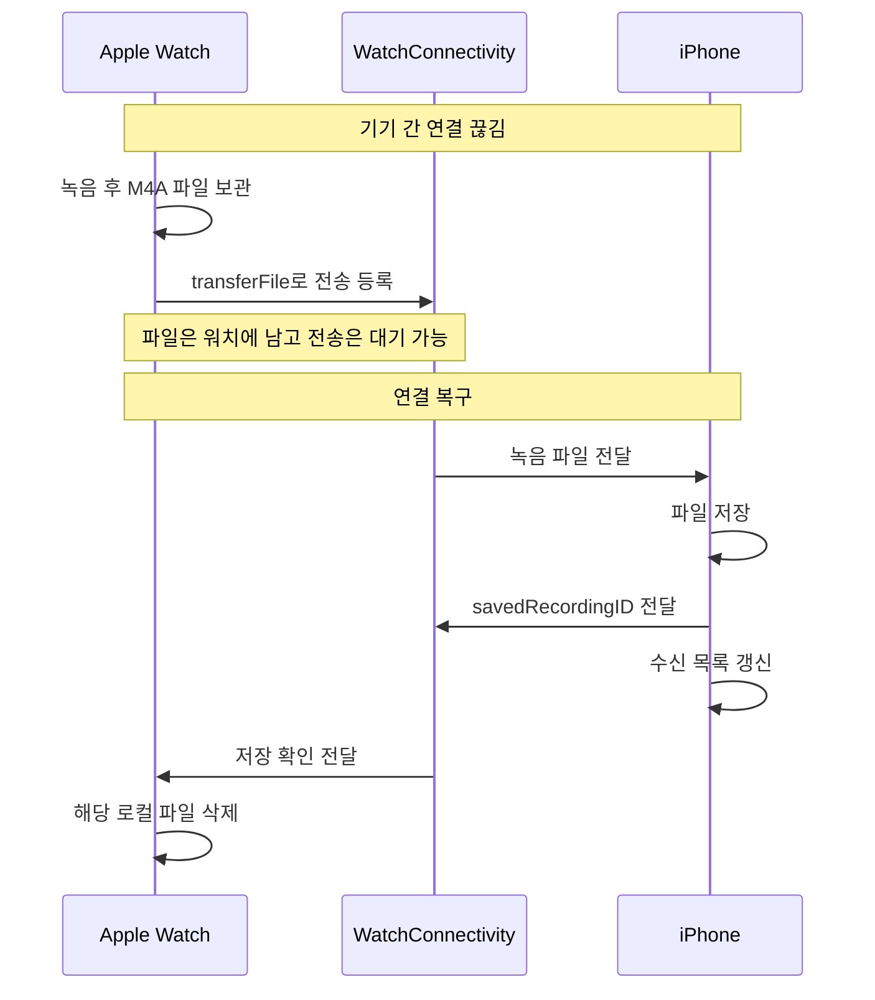
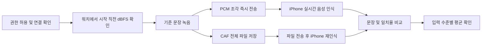
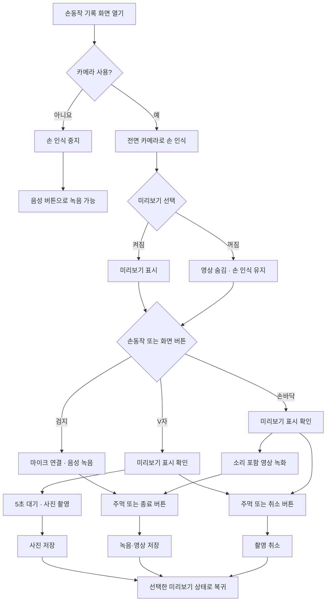

# AppleWatchPoC

## 소개

Apple Watch의 마이크로 녹음한 음성을 페어링된 iPhone으로 전달하는 과정과, iPhone 전면 카메라의 손동작으로 기록을 제어하는 기능을 검증하는 SwiftUI 프로젝트입니다. 기존 세 메뉴는 iPhone·watchOS 앱에 대응하며, **전면 카메라 · 손동작 기록**은 iPhone 앱에서 실행합니다.

첫 번째 **녹음 · 아이폰 동기화**는 연결이 끊긴 동안 워치가 녹음 파일을 보관하고, 연결이 복구되면 iPhone으로 보내는 동작을 확인합니다. iPhone의 저장 확인을 받은 후에만 워치 파일을 삭제합니다. 두 번째 **소음·거리 음성 기록 테스트**는 워치 마이크의 입력 수준과 iPhone의 음성 인식 결과를 기록해 환경 조건별로 비교합니다. 거리 자체를 자동 측정하지는 않습니다. 세 번째 **워치 비접촉 백그라운드 제어**는 단축어·AssistiveTouch로 녹음을 제어하고 손목 모션 마커와 녹음 시각을 기록합니다.

| 메뉴 | Apple Watch | iPhone |
| --- | --- | --- |
| 녹음 · 아이폰 동기화 | 녹음 시작·중지, 보관 중인 파일과 전송 상태 확인, 전송 재시도 | 수신 파일 재생·삭제, 수신 시각·길이·전송 측정값 확인 |
| 소음·거리 음성 기록 테스트 | 녹음 직전 마이크 입력 수준 표시, 시험 녹음 시작·중지 | 기준 문장, 실시간·파일 기반 음성 인식 결과와 일치율, 입력 수준별 평균 확인 |
| 워치 비접촉 백그라운드 제어 | 앱을 여는 시작·중지, 앱을 열지 않는 중지 단축어, 손목 모션 마커 | 시작·종료 시각과 경로, 마커 시점, 파일 재생 |
| 전면 카메라 · 손동작 기록 | 사용하지 않음 | 손동작으로 음성·사진·영상 기록, 카메라·미리보기 선택, 저장 파일 확인·공유 |

## 프로젝트 구조와 사용 프레임워크

Xcode 프로젝트는 `AppleWatchPoC.xcodeproj`이며 `AppleWatchPoC`(iOS)와 `AppleWatchPocWatch Watch App`(watchOS) 두 타깃으로 구성됩니다. 프로젝트 설정상 Swift 5, iOS/watchOS 배포 대상 27.0입니다. 외부 패키지 의존성은 없습니다.

| 프레임워크 | 사용처 |
| --- | --- |
| SwiftUI | 두 앱의 화면, 내비게이션, 앱 진입점 |
| Combine | `ObservableObject`, `@Published`, ViewModel의 상태 전달, 연결 상태 갱신 타이머 |
| WatchConnectivity | `WCSession`을 통한 즉시 메시지, 백그라운드 파일 전송, 저장 확인·측정값 전달 |
| AVFoundation | 워치 녹음·입력 레벨 측정·PCM 캡처, iPhone 파일 재생·녹음 길이 조회, 전면 카메라·사진·영상·음성 기록 |
| Vision | iPhone 전면 카메라 영상에서 손 관절을 찾아 제스처 판별 |
| Speech | iPhone의 한국어(`ko-KR`) 실시간 음성 인식과 수신 파일 음성 인식 |
| AppIntents | 비접촉 녹음 시작·중지 및 `AudioRecordingIntent` 기반 백그라운드 중지, App Shortcuts 등록 |
| CoreMotion | 녹음 중 손목 움직임을 감지해 커스텀 마커 기록 |
| WatchKit | 녹음·마커 햅틱 피드백, 녹음 시작 당시 워치 앱 상태 확인 |
| Foundation | 파일 관리, UUID, `UserDefaults`, JSON 직렬화, 시간 계산 |

## 1. 녹음 · 아이폰 동기화 테스트

### 사용 흐름

워치는 녹음이 끝나면 파일을 바로 지우지 않고 `Recordings` 디렉터리에 둡니다. `transferFile`을 요청한 뒤에도 iPhone의 **저장 확인 메시지**를 받을 때까지 보관합니다. 연결이 끊긴 동안에는 WatchConnectivity의 파일 전송 대기열에 남을 수 있고, 연결이 복구되면 시스템이 전달합니다. 워치 앱은 연결 상태가 다시 `reachable`이 될 때 아직 대기열에 없는 파일도 재등록합니다. 화면의 **동기화 재시도**는 이 등록을 수동으로 다시 실행합니다.

### 테스트 방법

| 단계 | 조작 | 확인할 결과 |
| --- | --- | --- |
| 1. 준비 | 페어링된 iPhone과 Apple Watch에 두 앱을 설치·실행하고, 각각의 녹음 동기화 화면을 엽니다. 워치의 마이크 권한을 허용합니다. | 기존 파일과 혼동되지 않도록 양쪽 목록의 현재 상태를 확인합니다. |
| 2. 연결 차단 | 워치와 iPhone 사이의 실제 통신 경로를 끊습니다. 예를 들어 두 기기를 충분히 떨어뜨리거나, 워치의 Bluetooth·Wi-Fi·셀룰러 등 사용 가능한 연결을 끕니다. | 워치에 **실시간 연결 안 됨**이 표시되고, 이후 새 녹음이 iPhone에 도착하지 않는지 확인합니다. 단순히 iPhone 앱을 백그라운드로 보내는 것만으로는 파일 전송까지 차단되지 않을 수 있습니다. |
| 3. 오프라인 녹음 | 워치에서 **녹음 시작**을 누르고 몇 초 말한 뒤 **녹음 중지**를 누릅니다. | 워치의 **워치에 보관 중** 목록에 새 UUID 파일이 남고, iPhone의 **워치에서 받은 녹음** 목록에는 아직 나타나지 않습니다. |
| 4. 연결 복구 | 차단한 통신 경로를 복구하고 두 앱을 확인합니다. 필요하면 워치에서 **동기화 재시도**를 누릅니다. | 전송 대기·진행 상태를 거쳐 같은 UUID의 파일이 iPhone 목록에 나타납니다. 백그라운드 파일 전송이므로 도착까지 시간이 걸릴 수 있습니다. |
| 5. 저장 확인 | iPhone에서 새 파일을 재생하고, 워치의 보관 목록을 다시 봅니다. | iPhone에서 녹음이 들리고, 저장 확인(`savedRecordingID`)이 워치에 도착하면 워치 목록에서 파일이 사라집니다. 전송 완료 직후에도 확인 메시지가 아직 오지 않았다면 잠시 남을 수 있습니다. |

**판정 기준:** 3단계에서 iPhone에 파일이 도착하지 않은 채 워치에 남고, 4~5단계에서 같은 UUID의 파일이 iPhone으로 전달·재생되며 저장 확인 후 워치에서 제거되면 핵심 동작을 확인한 것입니다. 워치의 **실시간 연결 안 됨**은 `sendMessage` 가능 여부를 뜻하며, 백그라운드 파일 전송 가능 여부와 정확히 같지는 않습니다. 오프라인 보관을 검증하려면 3단계에서 **iPhone에 실제로 파일이 도착하지 않았는지**도 함께 확인해야 합니다.

### 구현 흐름

| 순서 | 처리 위치 | 실제 동작 |
| --- | --- | --- |
| 1. 녹음 | 워치 | 마이크 권한을 받은 뒤 `AVAudioSession`을 활성화하고 `AVAudioRecorder`로 `Documents/Recordings/<UUID>.m4a`에 저장합니다. 형식은 AAC, 16 kHz, 모노, 32 kbps입니다. |
| 2. 전송 등록 | 워치 | 녹음 중지 후 `queuePendingRecordings()`가 아직 등록되지 않은 파일을 찾아 `WCSession.transferFile(_:metadata:)`에 넣습니다. `recordingID`, `fileBytes`, `fileExtension`을 함께 보냅니다. **동기화 재시도**도 같은 함수를 호출합니다. |
| 3. 연결 대기 | 워치·시스템 | 전송을 등록해도 워치의 원본 파일은 유지됩니다. 통신할 수 없으면 WatchConnectivity가 전송을 대기시키고, 연결 복구 후 전달합니다. |
| 4. 수신·저장 | iPhone | `didReceive file`에서 임시 파일을 `Documents/ReceivedRecordings/<UUID>.m4a`로 옮깁니다. 같은 UUID가 이미 있으면 중복 저장하지 않고, 수신 시각과 녹음 길이를 기록합니다. |
| 5. 저장 확인 | iPhone → 워치 | iPhone이 `transferUserInfo(["savedRecordingID": id])`를 보냅니다. 워치는 이 메시지를 받은 뒤에만 원본 파일을 삭제합니다. |
| 6. 확인·재생 | iPhone | 목록에서 파일을 `AVAudioPlayer`로 재생하거나 삭제합니다. 이 삭제는 iPhone 저장본에만 적용됩니다. |

`transferFile`과 `transferUserInfo`는 즉시 연결 여부와 별개로 시스템이 백그라운드에서 전달할 수 있는 WatchConnectivity 전송 방식입니다. 반면 화면의 **실시간 연결 가능**은 즉시 메시지를 주고받을 수 있는지 나타냅니다. 워치는 `isReachable`일 때 `connectionProbe` 메시지를 보내 응답을 확인하고, 화면이 보이는 동안 2초마다 다시 확인합니다. iPhone은 페어링 여부와 워치 앱 설치 여부도 상태에 반영합니다.

### 전송 시간 표시의 의미

워치는 실시간 연결 상태에서 파일을 전송 대기열에 넣거나, 대기 중인 파일에 실시간 연결이 다시 확인된 시각을 시작점으로 기록합니다. `didFinish fileTransfer`가 성공하면 그 시작점부터의 경과 시간과 파일 크기를 `transferUserInfo`로 iPhone에 보냅니다. iPhone은 `파일 크기 ÷ 경과 시간`으로 MB/s를 표시합니다. 연결된 시작 시각이 없으면 시간 측정 불가로 표시됩니다. 이 값에는 대기 시간이 포함될 수 있으므로 순수 무선 전송 속도나 정확한 송신 시작부터 수신 저장까지의 시간은 아닙니다.

## 2. 소음·거리 음성 기록 테스트

### 사용 흐름

### 테스트 방법

| 단계 | 조작 | 확인할 결과 |
| --- | --- | --- |
| 1. 준비 | iPhone과 워치에서 **소음·거리 음성 기록 테스트**를 엽니다. iPhone의 음성 인식 권한과 워치의 마이크 권한을 허용합니다. | 워치에 dBFS 숫자가 나타나고 iPhone에 기준 문장이 보입니다. 워치가 **실시간 연결 가능** 상태여야 합니다. |
| 2. 기준 조건 | 조용한 곳에서 워치를 착용하고 발화자와 워치 사이 거리를 일정하게 정합니다. iPhone의 기준 문장을 보며 워치에서 **녹음 시작**을 누르고 문장을 말한 뒤 **녹음 중지**를 누릅니다. | iPhone에 시험 항목이 생기고 **시작 직전 입력**, **실시간**, **파일 변환** 상태가 차례로 표시됩니다. |
| 3. 결과 확인 | 실시간·파일 변환이 모두 **완료**될 때까지 기다립니다. | 두 인식 문장과 각각의 일치율이 표시되고, 해당 dBFS 구간의 평균 집계에 시험이 포함됩니다. 전송이 끊겼으면 경고를 확인합니다. |
| 4. 조건 비교 | 같은 문장을 비슷한 목소리 크기로 반복하면서 거리 또는 주변 소음 조건을 한 번에 하나씩 바꿉니다. 조건별로 여러 번 녹음합니다. | 개별 일치율과 **입력 수준별 평균**을 비교합니다. 실제 거리와 환경 조건은 앱이 저장하지 않으므로 별도로 메모해 각 시험 시각과 대응시킵니다. |

**판정 기준:** 시험별로 시작 직전 dBFS와 실시간·파일 인식 문장/일치율이 기록되고, 완료된 시험만 입력 수준별 평균에 반영되는지 확인합니다. 연결이 끊겨 **실시간** 경로가 실패하면 경고가 표시될 수 있습니다. 그 경우에도 전체 CAF 파일이 나중에 전달되면 **파일 변환** 결과를 별도로 확인할 수 있습니다.

### 구현 흐름

| 순서 | 처리 위치 | 실제 동작 |
| --- | --- | --- |
| 1. 입력 수준 측정 | 워치 | 임시 `AVAudioRecorder`의 미터를 0.3초마다 읽어 dBFS를 표시합니다. 이전 값 70%와 새 값 30%를 섞고, 시작 직전 값을 `ambientDBFS`로 저장합니다. |
| 2. 녹음 시작 | 워치 | 즉시 연결과 마이크 권한을 확인한 뒤 `AVAudioEngine`으로 Float32 PCM을 캡처합니다. `Documents/Recordings/<UUID>.caf`에 기록하면서 녹음 중 RMS 입력 수준도 갱신합니다. |
| 3. 실시간 인식 준비 | 워치 → iPhone | `speechTestEvent: start`에 시험 ID·샘플레이트·dBFS를 담아 보냅니다. iPhone은 음성 인식 권한과 서비스를 확인해 `ready: true`로 응답합니다. |
| 4. 실시간 인식 | 워치 → iPhone | 워치가 약 0.25초 분량의 PCM을 `chunk` 메시지로 보냅니다. iPhone은 `SFSpeechAudioBufferRecognitionRequest`에 붙여 한국어 부분 인식 결과를 갱신합니다. |
| 5. 녹음 종료 | 워치 → iPhone | 워치가 남은 샘플과 `stop` 메시지를 보냅니다. iPhone은 입력을 종료하고 최종 결과를 기다립니다. 8초 안에 마무리되지 않으면 지연·중단 상태로 표시합니다. |
| 6. 파일 재인식 | 워치 → iPhone | 워치가 전체 CAF를 `transferFile`로 보냅니다. iPhone은 저장 후 `SFSpeechURLRecognitionRequest`로 다시 인식하고, 저장 확인 메시지를 워치에 보냅니다. |
| 7. 결과 비교 | iPhone | 기준 문장 **“오늘은 바람이 불지만 산책하기 좋은 날입니다”**에 대한 실시간·파일 인식 문장과 각각의 일치율을 보여 줍니다. |

현재 신규 시험은 `mode: "both"`로 생성됩니다. 수신 로직과 모델에는 이전/다른 데이터의 `"live"`, `"after"` 모드도 처리하는 분기가 있지만, 현재 워치 화면에서 선택하는 모드는 없습니다. 시험 시작 실패 시 워치는 캡처와 로컬 파일을 정리하고, 가능한 경우 `cancel` 메시지를 보냅니다. 실시간 `chunk` 전송이 실패하거나 연결이 끊기면 `speechStreamInterrupted`를 기록해 iPhone 결과에 경고를 표시합니다.

### 소음·거리 비교 로직과 해석

`PhoneRecordingModels.swift`의 `AmbientNoiseBand`는 **녹음 시작 직전 입력 dBFS**를 세 구간으로 나눕니다.

| 범위 | 화면 표시 |
| --- | --- |
| `dBFS < -50` | 조용한 편 |
| `-50 ≤ dBFS < -30` | 생활 소음 수준 |
| `dBFS ≥ -30` | 시끄러운 편 |

일치율은 기준 문장과 인식 문장을 소문자로 바꾸고 공백·문장부호를 제거한 다음, **문자 단위 편집 거리**를 계산합니다. `max(0, 1 - 편집 거리 / 기준 문장 글자 수) × 100`을 반올림한 값입니다. 실시간·파일 인식이 모두 `완료`이고 dBFS가 있는 `both` 시험만 구간별 평균에 포함합니다.

**거리 자체는 앱에서 측정하지 않습니다.** 거리 센서값이나 실측 dB SPL도 사용하지 않습니다. 화면의 dBFS는 워치 마이크가 받은 디지털 입력 레벨이며, 주변 소음만 분리한 측정값도 아닙니다. 거리에 따른 차이를 보려면 사용자가 발화 문장·목소리 크기·환경을 가급적 일정하게 유지하고 거리만 바꿔 반복 시험한 뒤 결과를 비교해야 합니다. 거리값을 입력하거나 기록하는 기능은 현재 없습니다.

## 3. 워치 비접촉 백그라운드 제어 테스트

워치에서 단축어 또는 AssistiveTouch 손 제스처로 녹음을 시작·중지하고, 손목 모션으로 중요한 시점에 커스텀 마커를 남기는 기능입니다. 화면은 **소음·거리 음성 기록 테스트**처럼 녹음 버튼을 중심으로 구성하지만 dBFS는 표시하지 않습니다. 녹음 중 경과 시간과 마커 수를 보여 주며, 마커 이름을 입력할 수 있습니다. iPhone의 **비접촉 제어**에서는 녹음 시작·종료 시각, 파일 길이, 시작·종료 경로, 종료 사유, 마커 시점을 확인하고 파일을 재생합니다.

### 단축어별 동작

단축어 앱에서 찾는 액션 이름에는 아래 표와 같이 **워치** 접두사가 붙습니다. 앱 바로가기의 짧은 이름은 각각 **비접촉 녹음 시작**, **비접촉 녹음 중지**, **백그라운드 녹음 중지**입니다.

| 액션 이름 | 기술·실행 설정 | 워치 앱 화면 | 실제 동작 |
| --- | --- | --- | --- |
| 워치 비접촉 녹음 시작 | `StartContactlessRecordingIntent: AppIntent`, `openAppWhenRun = true` | 앱을 엽니다. | 마이크 권한을 확인하고 녹음과 모션 감지를 시작합니다. |
| 워치 비접촉 녹음 중지 | `StopContactlessRecordingIntent: AppIntent`, `openAppWhenRun = true` | 앱을 엽니다. | 진행 중인 비접촉 녹음을 종료하고 파일·마커를 저장한 뒤 iPhone 전송을 예약합니다. |
| 워치 백그라운드 녹음 중지 | `StopBackgroundRecordingIntent: AudioRecordingIntent`, `openAppWhenRun = false`, `supportedModes = .background` | 앱을 열도록 요청하지 않습니다. | 이미 진행 중인 비접촉 녹음만 종료합니다. 새 오디오 세션을 활성화하거나 녹음을 시작하지 않습니다. |

**녹음 시작은 매번 워치 앱을 열어 실행합니다.** 설치 후 한 번만 앱을 열면 이후 모든 녹음을 백그라운드에서 시작할 수 있다는 뜻은 아닙니다. 시작된 녹음은 `WKBackgroundModes = [audio]` 설정으로 화면 꺼짐 이후에도 이어가도록 구성했습니다. 백그라운드 중지의 ‘앱을 열지 않음’은 시스템 단축어 알림까지 숨긴다는 뜻은 아닙니다.

세 액션은 **Apple Watch에서 실행**해야 합니다. iPhone에도 액션을 등록해 단축어 편집 시 찾을 수 있게 했지만, iPhone에서 실행하면 워치에서 실행하라는 오류를 반환합니다. iPhone 마이크를 사용하거나 iPhone에서 워치를 원격 제어하는 기능은 없습니다. 진행 중인 비접촉 녹음이 없으면 중지 액션은 새 파일을 만들지 않으며, 일반 녹음 동기화·음성 기록 테스트의 녹음을 중지하지 않습니다.

### 사용 흐름

1. **비접촉 녹음 시작** 단축어 또는 워치 화면의 **녹음 시작** 버튼으로 녹음을 시작합니다.
2. 손목을 흔들면 녹음을 유지하면서 해당 시점에 마커가 추가됩니다.
3. **비접촉 녹음 중지** 또는 **백그라운드 녹음 중지** 단축어를 실행합니다. 화면의 **녹음 중지** 버튼도 사용할 수 있습니다.
4. 워치가 녹음 파일과 시각·마커 정보를 보관하고 iPhone 전송을 예약합니다.
5. iPhone의 **비접촉 제어 → 시험 결과**에서 녹음을 재생하고 기록된 시각과 종료 경로를 확인합니다.

### 단축어와 AssistiveTouch 설정

| 단계 | 설정 | 확인할 결과 |
| --- | --- | --- |
| 1. 권한 준비 | 두 앱을 설치한 뒤 워치의 **워치 비접촉 백그라운드 제어** 화면에서 한 번 녹음하고 중지합니다. 마이크·모션 권한 요청이 나타나면 허용합니다. | 화면 버튼으로 녹음·마커·전송이 동작하는지 확인합니다. |
| 2. 단축어 생성 | iPhone 단축어 앱에서 위 표의 액션을 하나씩 넣어 세 단축어를 각각 만듭니다. 각 단축어의 세부사항에서 **Apple Watch에서 보기**를 켭니다. | 워치 단축어 앱에 시작·일반 중지·백그라운드 중지 단축어가 나타납니다. |
| 3. 직접 실행 | 워치 단축어 앱에서 먼저 시작과 일반 중지를 실행하고, 다시 시작한 뒤 백그라운드 중지를 실행합니다. | 제스처를 연결하기 전에 단축어 자체의 동작을 확인합니다. |
| 4. 제스처 지정 | 워치 설정 → 손쉬운 사용 → AssistiveTouch → 손 제스처에서 **한 번 집기 → 비접촉 녹음 시작**, **두 번 집기 → 원하는 중지 단축어**를 지정합니다. AssistiveTouch 활성화 제스처 설정도 확인합니다. | 앱을 열지 않고 중지하려면 두 번 집기에 **백그라운드 녹음 중지**를 선택합니다. |

한 번 집기·두 번 집기는 화면 탭이 아니라 손가락을 맞대는 AssistiveTouch 제스처입니다. 앱은 AssistiveTouch를 자동으로 켜거나 제스처 할당을 변경하지 않습니다. 시스템 더블 탭과도 구별되며, 시스템 더블 탭은 AssistiveTouch가 켜져 있으면 사용할 수 없습니다. [Apple Watch 사용 설명서](https://support.apple.com/en-ie/guide/watch/apdec70bfd2d/watchos)

기존에 만들어 둔 **실험 백그라운드 시작** 단축어는 더 이상 사용할 수 없으므로 단축어 앱에서 제거합니다. 기존 실험 중지 액션의 타입 식별자는 유지하지만, 목록에 이전 이름이 남으면 **워치 백그라운드 녹음 중지** 액션으로 다시 선택합니다.

### 테스트 방법

| 단계 | 조작 | 확인할 결과 |
| --- | --- | --- |
| 1. 시작 확인 | 워치에서 **비접촉 녹음 시작**을 실행합니다. | 워치 앱이 열리고 녹음이 시작됩니다. 동일 녹음 중 다시 시작해도 중복 파일을 만들지 않습니다. |
| 2. 일반 중지 | 몇 초 말한 뒤 **비접촉 녹음 중지**를 실행합니다. | 앱이 열리고 녹음이 종료됩니다. iPhone 결과의 종료 경로는 **일반 단축어 / AssistiveTouch**, 종료 사유는 **사용자 요청**입니다. |
| 3. 백그라운드 중지 | 다시 시작한 뒤 Digital Crown으로 시계 화면에 돌아갑니다. AssistiveTouch에 지정한 **백그라운드 녹음 중지**를 실행합니다. | 녹음 앱이 전면으로 열리지 않는지 확인합니다. iPhone 결과의 종료 경로는 **백그라운드 단축어 / AssistiveTouch**여야 합니다. 시스템 단축어 알림은 별도로 구분합니다. |
| 4. 화면 꺼짐·마커 | 다시 시작한 뒤 손목을 내려 화면이 꺼진 상태에서 30초 이상 말하고 손목을 흔듭니다. 이후 백그라운드 중지를 실행합니다. | 파일에 해당 구간의 음성이 들리는지, 마커가 예상 시점에 남았는지 각각 확인합니다. 화면 꺼짐·Always On·다른 앱·잠금은 서로 다른 조건으로 기록합니다. |
| 5. 장갑 비교 | 맨손과 라텍스 장갑 상태에서 같은 시작·마커·중지 동작을 반복합니다. | 손가락 제스처 누락, 손목 모션 마커 누락·중복, 일상 동작의 오검출을 구분해 기록합니다. |
| 6. 연결 복구 | 워치와 iPhone 연결을 끊고 녹음·중지한 뒤 연결을 복구합니다. 필요하면 기존 녹음 동기화 화면에서 전송을 재시도합니다. | 동일 녹음의 파일과 마커가 함께 도착하고 재생되는지 확인합니다. 수신 시각과 녹음 시작·종료 시각을 혼동하지 않습니다. |

**판정 기준:** 일반 시작·중지는 앱이 열리고, 백그라운드 중지는 녹음 앱을 열지 않은 채 기존 녹음을 종료해야 합니다. 종료 후 iPhone에서 파일을 재생할 수 있고, 실제 사용한 중지 경로·시각·마커가 함께 표시되어야 합니다. 빌드 성공만으로 AssistiveTouch나 화면 꺼짐 상태의 동작을 검증한 것으로 보지 않습니다. 특히 잠금·강제 종료 조건의 단축어 동작과 모션 수집 지속 여부는 실기기에서 확인해야 합니다.

### 구현 흐름

| 순서 | 처리 위치 | 실제 동작 |
| --- | --- | --- |
| 1. 시작 | 워치 | 화면과 단축어가 같은 `WatchRecordingSyncService.shared`를 사용합니다. 마이크 권한을 확인하고 AAC, 16 kHz, 모노, 32 kbps M4A 녹음을 시작합니다. |
| 2. 모션 마커 | 워치 | Core Motion의 device motion을 25 Hz로 읽습니다. 사용자 가속도 크기 1.1 g 초과와 회전 속도 크기 3 rad/s 초과가 동시에 발생하면 녹음 기준 상대 시점에 마커를 추가합니다. 낮은 움직임으로 돌아온 뒤 최소 2초 간격을 두어 재감지합니다. |
| 3. 로컬 저장 | 워치 | `<UUID>.contactless.json`에 시작 시각·경로·마커를 저장하고, 마커 추가 시 원자적으로 갱신합니다. 종료 시 종료 시각·경로·사유를 추가합니다. |
| 4. 중지 | 워치 | 화면·일반 단축어·백그라운드 단축어가 `stopContactless(trigger:)`를 호출합니다. 모션 감지와 녹음을 종료하고 녹음 파일을 전송 대기열에 등록합니다. |
| 5. 전송·확인 | 워치 → iPhone | 기존 `transferFile` 메타데이터에 `contactlessRecording` JSON을 포함합니다. iPhone은 파일과 JSON을 저장하고 `savedRecordingID`를 반환합니다. 워치는 저장 확인 후 원본과 JSON을 제거합니다. |
| 6. 결과 표시 | iPhone | 수신한 비접촉 녹음을 시작 시각순으로 표시합니다. 일반·백그라운드 중지 결과를 같은 화면에서 비교할 수 있습니다. 이전 실험에서 수신한 비접촉 녹음도 목록에 유지됩니다. |

### 결과 해석과 제한

- **마커:** 녹음의 중요한 시점에 남기는 책갈피입니다. `+80.0초 · 커스텀 마커`는 녹음 시작 후 80초에 해당합니다. 마커는 녹음을 끊지 않으며, 현재 마커를 눌러 해당 시점으로 이동하는 재생 기능은 없습니다.
- **모션 인식:** 가속도·회전 속도 임계값을 사용하는 손목 흔들기 실험입니다. 손목 비틀기 전용 분류기나 Apple의 시스템 Wrist Flick 연결이 아닙니다. 임계값은 장갑·작업 환경·착용 상태에 따라 오검출될 수 있습니다.
- **종료 경로와 사유:** 경로는 **워치 버튼 / 일반 단축어 / 백그라운드 단축어**를 구분하고, 사유는 **사용자 요청 / 오디오 인터럽트 / 시스템 종료 / 녹음 오류** 등을 구분합니다. 단축어 직접 실행과 AssistiveTouch 실행은 같은 Intent로 들어오므로 둘을 자동 구분하지 않습니다. 이전 버전 녹음의 누락된 종료 경로는 추정하지 않고 **미기록**으로 표시합니다.
- **예기치 않은 종료:** 앱 재실행 시 종료 시각이 없는 기록은 파일 길이로 종료 시각을 추정해 복구하고 종료 사유에 표시합니다. 인터럽트로 종료된 녹음을 자동으로 다시 시작하지 않습니다.
- **백그라운드 시작:** 제공하지 않습니다. 새 녹음은 앱을 여는 시작 액션을 사용합니다. 백그라운드 중지 액션은 기존 녹음을 종료할 뿐 새 마이크 세션이나 Live Activity를 시작하지 않습니다.

실제 마이크·AssistiveTouch·백그라운드 실행 검증은 위 실기기 절차로 수행합니다.

## 4. 전면 카메라 · 손동작 기록

iPhone 홈에서 **전면 카메라 · 손동작 기록**을 엽니다. 처음에는 **핸드트래킹 카메라**와 **핸드트래킹 미리보기**가 모두 켜져 있습니다. 카메라 권한을 허용하면 전면 카메라로 손을 인식하고 화면에 미리보기를 보여 줍니다. 미리보기만 끄면 영상은 숨지만 손 인식용 카메라는 계속 작동합니다. 카메라 토글을 끄면 촬영과 손 인식이 모두 멈추며, 마이크 권한이 있다면 화면의 **음성** 버튼으로 카메라 없이 녹음할 수 있습니다.

| 손동작 | 동작 | 시작 조건 |
| --- | --- | --- |
| 검지 하나 | 음성 녹음 시작 | 마이크 권한 필요 |
| V자 | 사진 촬영 준비 | 카메라 필요. 미리보기 표시 확인 후 5초가 지나면 촬영 |
| 손바닥 | 영상 녹화 시작 | 카메라·마이크 권한 필요. 미리보기가 표시된 뒤 녹화 시작 |
| 주먹 | 촬영 준비 취소 또는 녹음·녹화 종료 | 카메라로 손을 인식할 수 있어야 함 |

손 전체를 카메라에 보여 주고 동작을 약 **0.9초** 유지하면 실행됩니다. 같은 동작을 다시 쓰려면 손을 화면 밖으로 빼거나 인식되지 않는 자세로 **0.5초** 이상 둡니다. 정면 주먹은 손가락 관절이 겹칠 수 있어 손바닥 크기 대비 손끝이 모인 정도도 판별합니다. 화면의 **음성·사진·영상·촬영 취소·기록 종료 및 저장** 버튼으로도 조작할 수 있습니다. 카메라를 끈 상태에서는 주먹으로 종료할 수 없으므로 종료 버튼을 사용합니다.

### 촬영 흐름

사진·영상 제스처를 사용하면 미리보기를 꺼 둔 상태에서도 촬영 준비 중에는 자동으로 보여 줍니다. 사진의 **5초는 화면에 미리보기가 실제 표시된 뒤부터** 셉니다. 영상은 미리보기가 표시되면 녹화를 시작하며 5초 대기가 없습니다. 종료·취소 후에는 사용자가 고른 미리보기 설정으로 돌아갑니다. 카메라 켜기·끄기는 기록 또는 촬영 준비를 마친 뒤 바꿀 수 있습니다.

### 저장과 동작 범위

파일은 iPhone 앱의 `Documents/HandTrackingRecords`에 저장됩니다. 음성은 `.m4a`, 사진은 `.jpg`, 소리가 포함된 영상은 `.mov`입니다. 녹음·녹화 중 파일은 `Pending` 하위 폴더에 두고 완료 후 저장 목록으로 옮깁니다. 오른쪽 위 **저장 목록**에서 파일을 확인·미리보기·공유할 수 있습니다. 이 기능의 파일은 Apple Watch로 전송하거나 사진 앱에 자동 저장하지 않습니다.

손 인식은 Vision으로 일정 간격의 프레임만 처리합니다. 대기 중에는 낮은 해상도를 쓰고, 영상 녹화는 기기에서 지원하는 720p·60fps를 우선 선택합니다. 해당 형식이 없으면 지원되는 1080p·60fps 또는 30fps로 녹화합니다. 실제 프레임 유지율과 배터리 사용량은 기기와 촬영 조건에 따라 달라지므로 실기기에서 확인해야 합니다. 화면을 나가거나 앱이 백그라운드로 이동하면 진행 중인 기록을 마무리합니다.

## iPhone ↔ Apple Watch 통신 요약

| 방향·API | 데이터 | 사용 조건·목적 |
| --- | --- | --- |
| 워치 → iPhone `sendMessage` | `connectionProbe` | 즉시 연결 확인. iPhone이 응답 |
| 워치 → iPhone `sendMessage` | `speechTestEvent`: `start`, `chunk`, `stop`, `cancel` | 실시간 음성 시험 제어와 PCM 전달. 즉시 연결 필요 |
| 워치 → iPhone `transferFile` | M4A/CAF 파일과 UUID·크기·형식·시험 메타데이터, 비접촉 녹음의 `contactlessRecording` JSON | 녹음 완료 후 시스템 파일 전송 대기열 사용 |
| iPhone → 워치 `transferUserInfo` | `savedRecordingID` | iPhone 저장 확인. 워치 로컬 파일 삭제 트리거 |
| 워치 → iPhone `transferUserInfo` | `transferMetricID`, `fileBytes`, 선택적 `elapsedSeconds` | 전송 완료 측정값 표시 |

두 앱은 같은 UUID를 파일명, 메시지의 `id`, 전송 메타데이터의 `recordingID`, 저장 확인의 `savedRecordingID`에 사용해 하나의 녹음/시험을 연결합니다. 파일은 각 앱의 자체 Documents 디렉터리에 저장되고, 전송 측정값·녹음 상세 정보·시험 결과는 각 앱의 `UserDefaults`에 저장됩니다. `WCSession`은 앱 간 데이터 전달을 담당하며 오디오 녹음이나 음성 인식 자체를 수행하지 않습니다.

## 실행 준비

Xcode에서 `AppleWatchPoC.xcodeproj`를 열고 페어링된 iPhone과 Apple Watch에 각각의 앱을 설치합니다. 이후 위의 **테스트 방법**을 메뉴별로 진행합니다. 연결 끊김·복구와 마이크 입력을 검증하려면 실제 기기에서 확인하는 것이 적합합니다.

워치 마이크 권한 설명(`NSMicrophoneUsageDescription`)과 iPhone 음성 인식 권한 설명(`NSSpeechRecognitionUsageDescription`)은 별도 plist 파일이 아니라 Xcode 프로젝트의 생성 Info.plist 설정에 들어 있습니다. 실시간 시험은 `sendMessage`를 쓰므로 두 앱 간 즉시 통신이 가능해야 시작됩니다. 일반 녹음의 파일 전송은 연결이 복구될 때까지 대기할 수 있습니다.

전면 카메라 손동작 기록에는 iPhone의 카메라·마이크 권한이 필요합니다. `NSCameraUsageDescription`과 iPhone의 `NSMicrophoneUsageDescription`은 같은 Xcode 프로젝트 설정에 있습니다. 카메라를 끄고 음성 버튼만 사용하는 경우에는 카메라 권한 없이 마이크 권한으로 녹음할 수 있습니다.

비접촉 녹음의 오디오 백그라운드 모드(`WKBackgroundModes = [audio]`)와 모션 권한 설명(`NSMotionUsageDescription`)은 `Configuration/WatchInfo.plist`에 있습니다. 단축어는 워치에서 실행하며, 제스처 매핑은 사용자가 AssistiveTouch 설정에서 지정합니다.
